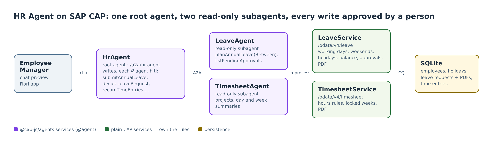
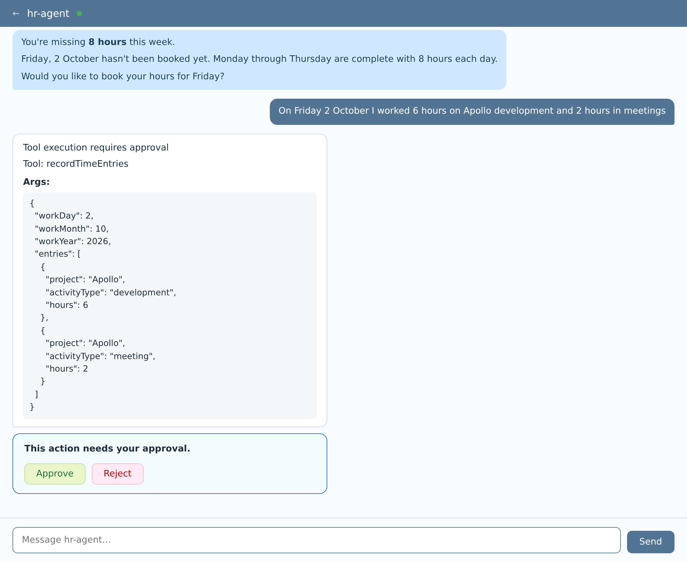
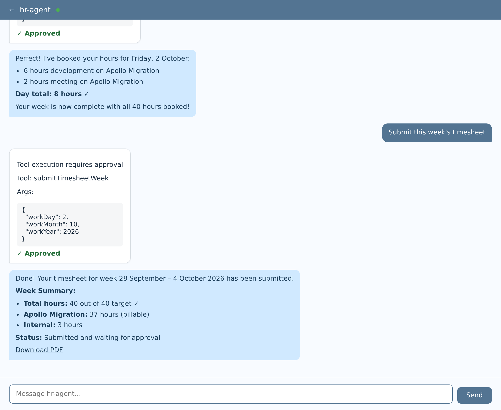
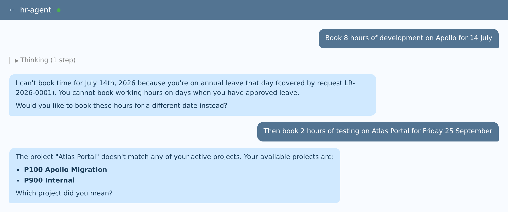
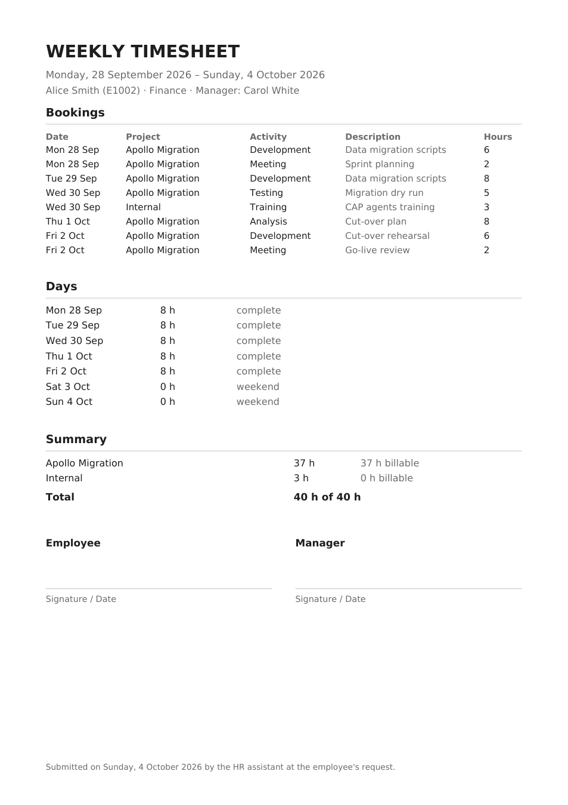
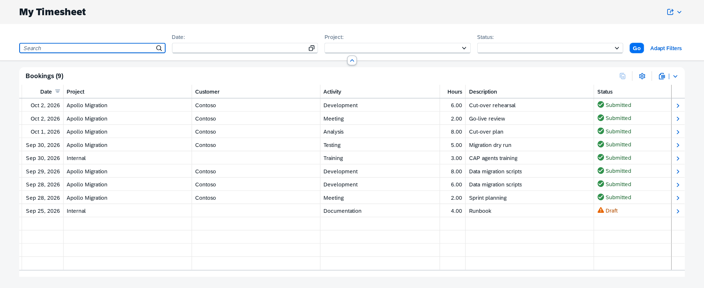
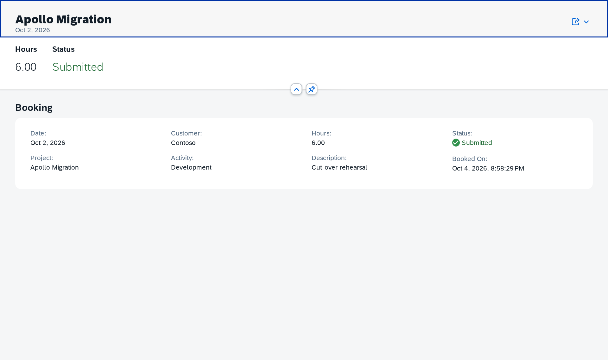

# Booking Hours by Chat: A Timesheet Agent on SAP CAP, Built the XTravels Way

*The second domain of a multi-agent HR assistant on SAP CAP: employees book working hours in plain sentences, the agent knows their projects and their leave days, and a person approves every booking. It follows the structure of the XTravels sample from the CAP September 2026 release.*

---

## Where this comes from

The [September 2026 release of SAP CAP](https://cap.cloud.sap/docs/releases/2026/sep26#new-xtravels-sample) introduced **CAP-level agents**. With them, one annotation turns a CAP service into an agent that runs a ReAct loop inside the CAP server and is served over the Agent-to-Agent protocol (A2A):

```cds
@agent service TravelAgentService { ... }
```

The release also shipped the **[XTravels sample](https://cap.cloud.sap/docs/guides/ai/xtravels-sample)**. It has a root agent (`TravelAgentService`) that coordinates subagents over A2A (`EventsService`, `HotelsService`), an `AGENTS.md` with one `SKILL.md` per task, and an `@agent.hitl` annotation on the one action that books something. With that annotation, the person in the chat approves the action before it runs.

In the first article of this series I used that structure for annual leave and manager approval. This one covers the second domain of the same application: **time recording**. Most people dislike it, it follows company-specific rules, and it touches the leave domain on every single day.

## What the assistant does

An employee writes

> On Friday 2 October I worked 6 hours on Apollo development and 2 hours in meetings

and the assistant does five things:

- finds the project from "Apollo";
- maps "development" and "meetings" to activity types;
- checks the day against the rules and against the employee's leave;
- saves the two bookings after one click on Approve;
- at the end of the week, submits the timesheet with a PDF.

A read-only Fiori Elements app shows every booking.


*The same application as the leave article: one root agent, two read-only subagents, and plain CAP services that own the rules.*

## How XTravels maps to time recording

The building blocks are the same as in XTravels:

- **The root agent is `HrAgent`**, like `TravelAgentService`. It talks to the employee and does all the writing.
- **`TimesheetAgent` is a subagent** reached over A2A, like `HotelsService` or `EventsService`. It answers questions about projects, a day's bookings and a week's totals.
- **`TimesheetService` is a plain CAP service** that owns the rules and the data: projects, assignments, activity types, bookings, submitted weeks and their PDFs.
- **The write tools carry `@agent.hitl`**, like `createTravel`: `recordTimeEntries`, `deleteTimeEntry` and `submitTimesheetWeek`.
- **A `time-recording` skill** sits next to the root agent's `AGENTS.md`, just as XTravels has one skill per subtask.

XTravels stresses that its services "have no knowledge about or dependency on each other". The same is true here, and time recording shows why that matters. `TimesheetService` knows nothing about leave, and `LeaveService` knows nothing about timesheets. Yet nobody should be able to book eight hours on a day they were on holiday. That check belongs to the **root agent**, the one place that sees both domains.

## Inside the multi-agent system

### The subagent only reads

`TimesheetAgent` is an agent of its own, with its own `AGENTS.md`. Its three functions become its tools:

```cds
@agent
@agent.connect: 'none'
@requires: 'authenticated-user'
service TimesheetAgent {
  /** The user's active projects, the activity types that can be booked, and today's date. */
  function listMyProjects() returns { projects : many ts.ProjectInfo; activities : many ts.ActivityInfo; today : Date; };

  /** The user's bookings on one day, with the day's total. */
  function getDayEntries(workDay : Integer, workMonth : Integer, workYear : Integer) returns ts.DayCheck;

  /**
   * Hours per day and per project for the week containing the given day,
   * against the daily target, and whether the week was already submitted.
   * Leave days are not known here; they show as missing hours.
   */
  function getWeekSummary(workDay : Integer, workMonth : Integer, workYear : Integer) returns ts.WeekSummary;
}
```

It has no write tools, and that is deliberate. An approval requested by `@agent.hitl` *inside a subagent* does not travel back through A2A to the person in the chat. So every booking goes through the root agent, and the approval card appears where the employee is.

### The root agent writes, and checks leave first

The root agent has one tool without approval and three with it:

- **`previewTimeEntries`** checks bookings without saving them, so it needs no approval.
- **`recordTimeEntries`** saves the bookings of a day.
- **`deleteTimeEntry`** removes a draft booking.
- **`submitTimesheetWeek`** locks the week and creates the PDF.

The last three are gated with `@agent.hitl`. Here is how they are declared:

```cds
service HrAgent {
  action previewTimeEntries(workDay : Integer, workMonth : Integer, workYear : Integer,
                            entries : many TimeEntryInput not null) returns ts.DayCheck;

  @agent.hitl
  action recordTimeEntries(workDay : Integer, workMonth : Integer, workYear : Integer,
                           entries : many TimeEntryInput not null) returns ts.DayCheck;

  @agent.hitl action deleteTimeEntry(entryId : UUID not null) returns ts.Entry;
  @agent.hitl action submitTimesheetWeek(workDay : Integer, workMonth : Integer, workYear : Integer) returns ts.WeekSummary;
}
```

Preview and record share one handler, so what was previewed is exactly what gets saved. Before anything reaches `TimesheetService`, the handler asks `LeaveService` whether the employee is on leave that day:

```ts
function timeEntries(leave: cds.Service, timesheet: cds.Service, event: "checkEntries" | "addEntries") {
  return async function (req: cds.Request) {
    const args = req.data as Args;
    const workDate = workDateFrom(req, args, today());
    const onLeave = (await forward(req, () => leaveDaysBetween(leave, workDate, workDate))).get(workDate);
    if (onLeave) {
      return req.reject(409, `You are on annual leave on ${workDate} (request ${onLeave}); no time can be booked for that day.`);
    }
    return forward(req, () => timesheet.send(event, { workDate, entries: args.entries }));
  };
}
```

The same cross-check applies when a week is submitted. The root agent looks up the leave days of that week and passes them to `TimesheetService`, which marks them in the PDF instead of counting them as missing hours.

### The rules live in the service

The model translates the sentence. It never decides whether a booking is valid. `TimesheetService` does, in a pure function with ordinary unit tests:

```ts
export function checkDay(args: { workDate: string; today: string; hours: number[]; bookedBefore: number;
                                 weekSubmitted: boolean; holiday?: string; dailyHours: number }) {
  if (workDate > today) throw new TimesheetRuleError(`${workDate} is in the future (today is ${today}). Time can only be booked for work already done.`);
  if (weekSubmitted) throw new TimesheetRuleError(`The week starting ${weekStart} has already been submitted and is locked.`);
  for (const h of hours) {
    if (!(h > 0) || h > MAX_HOURS_PER_DAY || Math.round(h * 4) !== h * 4) {
      throw new TimesheetRuleError(`${h} is not a valid number of hours. Use quarter hours between 0.25 and ${MAX_HOURS_PER_DAY}.`);
    }
  }
  // … at most 12 hours a day; warnings for weekends, holidays and days still short of the target
}
```

Every error is written for the model. It says what is wrong and what to do next, so the agent can pass it on without guessing. The project lookup works the same way: "Apollo" resolves to `P100 Apollo Migration` by ID, name or customer. When nothing matches, the error lists the projects the employee *can* book on.

### Every call runs as the employee

The services resolve the employee from `$user`, never from a parameter. That holds for every hop: from the root agent to the subagent, and from there to the service. Nobody can book or read time for someone else, and "my projects" really means the projects this person is assigned to.

## The application in action

These screenshots come from a live run against a Claude Sonnet model on SAP AI Core, logged in as the mocked user `alice`, using the chat preview of `@cap-js/agents`.

### 1. What is missing, then one sentence to fix it


*"How many hours am I missing this week?" Then one sentence becomes two bookings behind a single approval card.*

The root agent asks `TimesheetAgent` for the week summary and finds Friday empty. Its `AGENTS.md` tells it to check with `LeaveAgent` before calling any day "missing", because a gap in the timesheet may simply be a leave day, and the timesheet agent cannot know. The booking sentence then becomes one `recordTimeEntries` call with two entries, and the approval card shows exactly what will be saved.

### 2. Booked, then the week submitted


*Approve, and the day is booked. "Submit this week's timesheet" opens a second card, and the week is locked with its PDF.*

Submitting is a separate write with its own approval, because it locks every booking of the week. After that, any change is refused with "The week starting 2026-09-28 has already been submitted and is locked."

### 3. The rules say no


*Two refusals, both from the services: a leave day, and a project the employee is not assigned to.*

The first refusal comes from the root agent's cross-check: 14 July is covered by the approved leave request LR-2026-0001. The second comes from `TimesheetService`: Alice is not assigned to Atlas Portal, and the error lists the projects she can book on.

This screenshot also has a small story behind it. In the first live run, the list of "projects you can book on" included *Legacy Archive*, a project that is closed. The rule had listed every assigned project, open or not. The fix was two lines in `resolveProject`: offer only open projects, and when a name matches one open and one closed project, take the open one. Two unit tests now cover it. The model had faithfully repeated what the service told it. The mistake was in the service, so that is where the fix went.

### 4. The weekly timesheet PDF


*Bookings, hours per day against the target, weekends and leave days marked, and billable hours per project.*

The PDF is generated with pdf-lib when the week is submitted. It is stored as a `LargeBinary` with `@Core.MediaType`, so OData serves it at `MyTimesheetWeeks(<ID>)/pdf`, and only to its owner.

### 5. A read-only Fiori app on the same service

XTravels expects the classic UI to shrink to "simple mostly readonly UIs" once agents do the work. **My Timesheet** is exactly that: a Fiori Elements List Report and Object Page on `TimesheetService.MyTimeEntries`, the same projection the agents read. The same `@restrict` rule limits it to the logged-in employee:

```cds
@readonly
@restrict: [{ grant: 'READ', where: 'employee.userId = $user' }]
entity MyTimeEntries as projection on hr.TimeEntries {
  *,
  project.name      as projectName  : String(100),
  project.customer  as customer     : String(100),
  activityType.name as activityName : String(60),
  case status when 'draft' then 'Draft' when 'submitted' then 'Submitted' end as statusText : String(20),
  case status when 'submitted' then 3 else 2 end as statusCriticality : Integer,
};
```

The calculated elements carry the project, customer and activity names and the status colour. The annotations then only arrange them: a line item, filters for date, project and status (with value helps), and a sort order with the newest day first.


*Every booking, made by chat or otherwise. The submitted week is green, and a draft from the week before is still orange.*


*One booking in detail.*

The app has no API of its own. A booking made in the chat appears in the table on the next refresh.

## What I take from it

1. **The domains meet in the root agent, not in the services.** `TimesheetService` stays ignorant of leave, as XTravels' services stay ignorant of each other. The one rule that needs both domains (no booking on a leave day) is a dozen lines in the root agent.
2. **Subagents read, the root agent writes.** `@agent.hitl` only reaches the person from the root agent. Every booking, deletion and submission lives there.
3. **Preview and record share one code path.** What the employee approved is exactly what gets saved, and the service checks it again on save.
4. **Write errors for the model.** "No project of yours matches 'Atlas Portal'. The projects you can book on are: P100 Apollo Migration, P900 Internal. Ask which one is meant." reads like an instruction, and the agent follows it.
5. **Test the service, not the prompt.** The bug that the live run surfaced was in a rule, it was fixed in a rule, and a unit test keeps it fixed.

Not covered yet: a manager approving submitted weeks, overtime and absence types other than annual leave, and running the timesheet domain as a separate process. XTravels already shows how with its late-cut microservices.

## Try it yourself

```sh
npm install
npm run db:reset          # SQLite with employees, projects, assignments and last week's bookings
npm run watch:claude      # ANTHROPIC_API_KEY in the shell: real model, mocked users
npm run hybrid            # or SAP AI Core via a destination
npm test                  # 52 unit and integration tests
```

Then log in as `alice` with an empty password and open:

- the chat at `http://localhost:4004/a2a/hr-agent/preview/`;
- the app at `http://localhost:4004/timesheet/webapp/index.html`.

Try "How many hours am I missing this week?" first.

For the structure this project follows, see the [XTravels sample guide](https://cap.cloud.sap/docs/guides/ai/xtravels-sample) and the [September 2026 release notes](https://cap.cloud.sap/docs/releases/2026/sep26#new-xtravels-sample).

---

*Built with SAP CAP 10, `@cap-js/agents` 0.9 and SAPUI5 Fiori Elements, following the structure of the CAP XTravels sample.*
