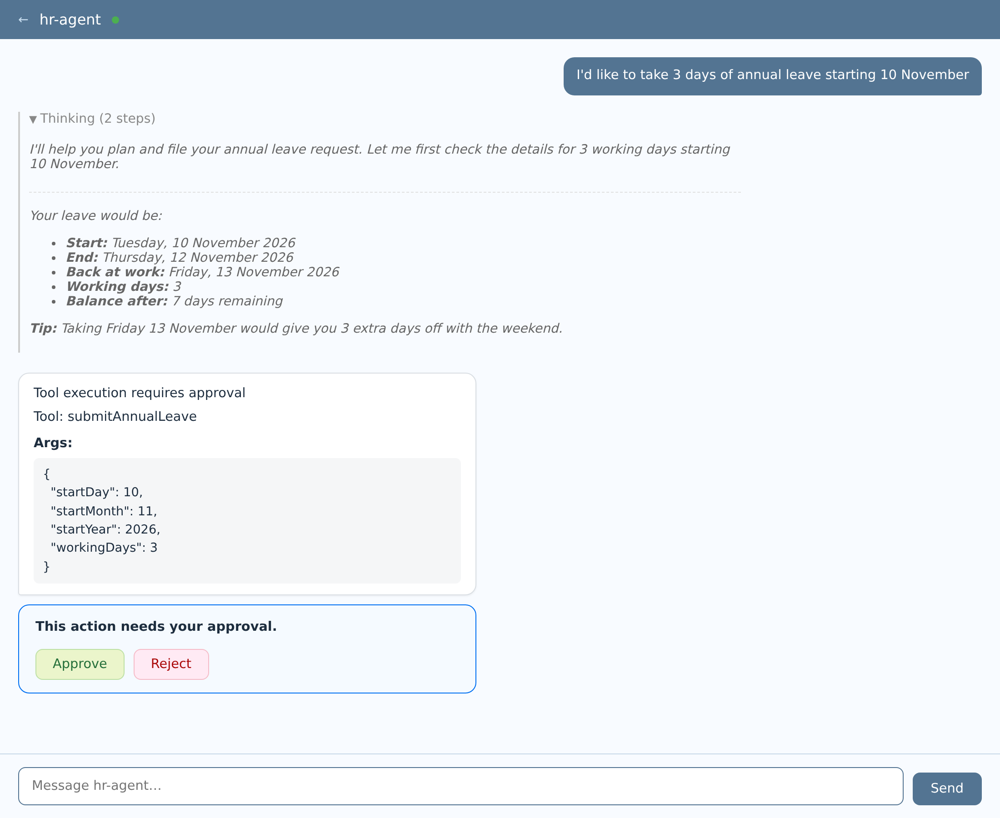
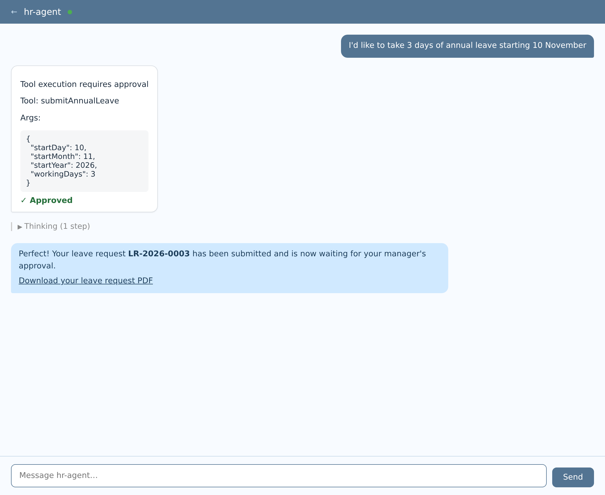
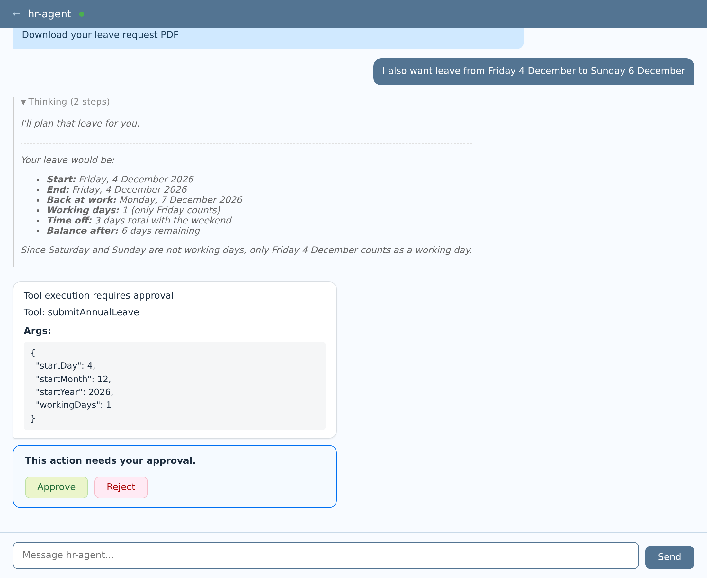
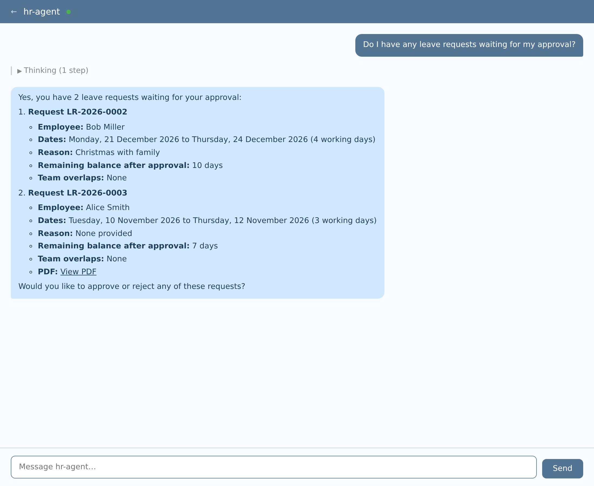
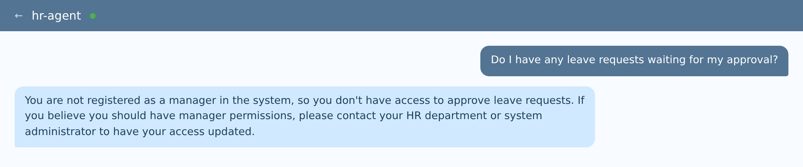
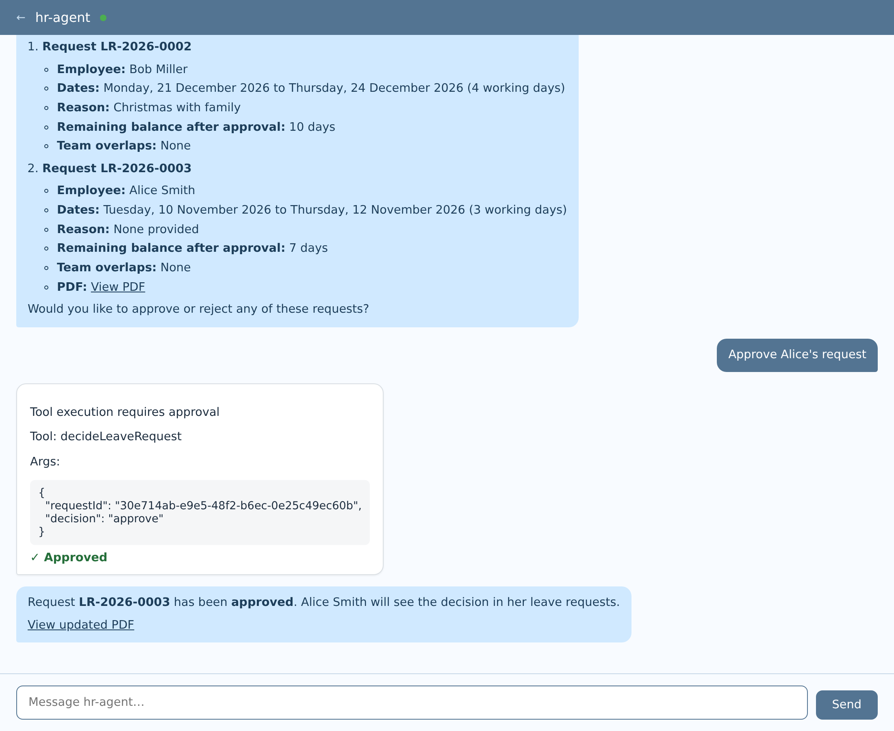
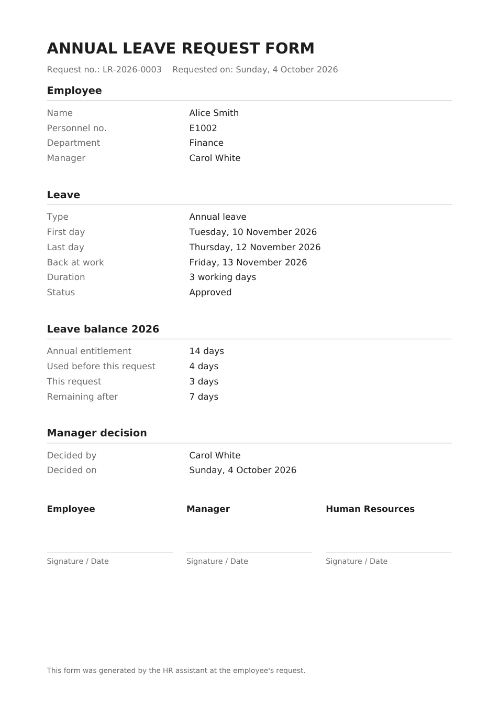
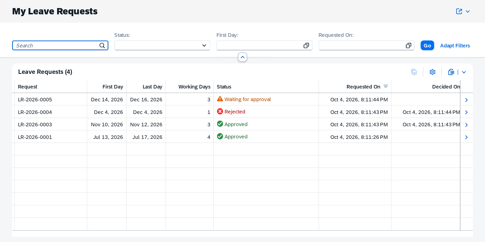
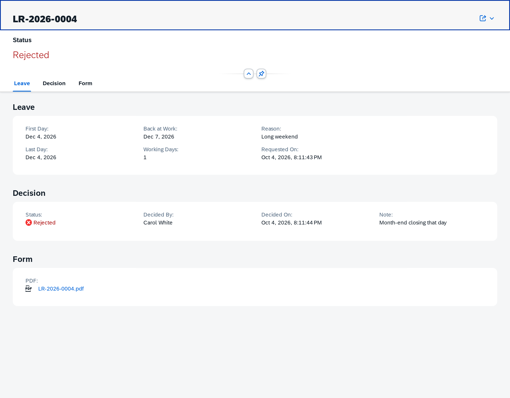

# HR Agent — annual leave and time recording by chat

A multi-agent HR assistant on SAP CAP and [`@cap-js/agents`](https://www.npmjs.com/package/@cap-js/agents),
built the way the [XTravels sample](https://cap.cloud.sap/docs/guides/ai/xtravels-sample)
is built: one root agent that talks to the employee and delegates over A2A to
one subagent per domain.

> I'd like to take 3 days of annual leave starting 10 November, can you plan it?
>
> Today I worked 4 hours on Apollo development and 2 hours in meetings.
>
> Do I have any leave requests waiting for my approval? *(as a manager)*

The assistant plans leave and books hours, saves them in SQLite once the
employee approves, and returns PDF forms: a leave request, and a weekly
timesheet. Managers see the leave requests of their team that wait for them,
and approve or reject them in the same chat.

## How it is built

```
employee ──chat──▶ HrAgent  (root agent, /a2a/hr-agent)
                     │  A2A ──▶ LeaveAgent      (/a2a/leave-agent)      ──▶ LeaveService      (/odata/v4/leave)
                     │  A2A ──▶ TimesheetAgent  (/a2a/timesheet-agent)  ──▶ TimesheetService  (/odata/v4/timesheet)
                     └─ writes, each @agent.hitl ───────────────────────────▶ LeaveService, TimesheetService
```

Each domain has two services, a base service and an agent over it:

| Domain | Base service | Subagent |
|---|---|---|
| Leave | `LeaveService` — working days, public holidays, balance, overlaps; leave requests and their PDF; the manager's approval. | `LeaveAgent` — balance, planning, listing, pending approvals. Read-only. |
| Time recording | `TimesheetService` — assigned and active projects, quarter hours, at most 12 h a day, no future dates, locked weeks; bookings and the weekly PDF. | `TimesheetAgent` — projects, a day's bookings, a week's totals. Read-only. |

The base services own the rules and the data and are served over OData, so a
UI or another system gets the same rules as the chat. They do not know each
other, as in XTravels.

`HrAgent` is the root agent, like `TravelAgentService` in XTravels:

- **It delegates questions over A2A.** `@agent.connect: ['LeaveAgent', 'TimesheetAgent']`
  turns each subagent into one tool; the server log shows
  `Connecting to subagent LeaveAgent (local)` on the first request.
- **It does all the writing itself**, with tools marked `@agent.hitl`, so the
  employee approves every write. The subagents are read-only because an
  approval requested inside a subagent does not travel back through A2A.
- **It is where the domains meet.** It refuses a time booking on a leave day
  before the booking reaches `TimesheetService`, and marks leave days in the
  weekly PDF.

Every call acts for the logged-in user: the base services resolve the
employee from `$user` (`hr.Employees.userId`). Calls to subagents and base
services run in-process and carry the user in `cds.context`.

### The tools

| Agent | Tool | Writes | What it does |
|---|---|---|---|
| `LeaveAgent` | `getLeaveBalance` | no | Entitlement, used, pending, remaining, and today's date. |
| | `planAnnualLeave` | no | Day + month (+ optional year) and working days → start, end, return date, skipped days, the whole break with adjacent weekends, bridge days, balance after. |
| | `planAnnualLeaveBetween` | no | The same for a date range ("Friday 4 to Sunday 6 December"); a start or end on a weekend or holiday is trimmed and reported. |
| | `listMyLeaveRequests` | no | The employee's requests in a year. |
| | `listPendingApprovals` | no | Managers only: the team's requests waiting for them, with balance after approval and team overlaps. |
| `TimesheetAgent` | `listMyProjects` | no | Active projects, activity types, today's date. |
| | `getDayEntries` | no | Bookings of one day (default today). |
| | `getWeekSummary` | no | Hours per day and project against the target, status, PDF link. |
| `HrAgent` | `submitAnnualLeave` | yes, `@agent.hitl` | Files a planned leave and creates its PDF. |
| | `cancelLeaveRequest` | yes, `@agent.hitl` | Cancels a request that has not started. |
| | `decideLeaveRequest` | yes, `@agent.hitl` | Managers only: approves or rejects a team member's request (a rejection needs a note) and updates its PDF. |
| | `previewTimeEntries` | no | Checks bookings for a day: project resolution ("Apollo" → P100), leave day, rules. |
| | `recordTimeEntries` | yes, `@agent.hitl` | Saves the previewed bookings. |
| | `deleteTimeEntry` | yes, `@agent.hitl` | Deletes a draft booking. |
| | `submitTimesheetWeek` | yes, `@agent.hitl` | Locks the week and creates the weekly PDF. |

Every `@agent.hitl` tool opens an approval card with Approve and Reject
buttons in the chat preview. The root agent's AGENTS.md tells it to call the
tool right after showing what it will do, so that card is the one
confirmation. Typed answers work too, but only `approve`, `yes`, `confirm`
and `ok` count as approval; anything else, including "yes" in another
language, is a rejection.

### Weekends and holidays

`srv/leave/lib/leave-calendar.ts` holds the leave arithmetic as pure
functions, covered by `test/unit/leave-calendar.test.ts`:

- weekends and public holidays inside a leave do not count, and are listed;
- a leave starting on a non-working day is refused, naming the next working day;
- a date range is trimmed to working days at both ends (`adjustments`), and a
  range without a working day is refused;
- every plan reports the whole break including adjacent weekends and holidays
  (`timeOff`, e.g. Monday–Friday = 9 days off) and the bridge days next to it.

### The approval card

`srv/server.ts` extends the plugin's chat preview, in development only, with
`srv/preview/approval-card.{css,js}`: the tool and its arguments in one
bubble, the decision in a separate box with a green Approve and a red Reject,
and a record of the decision left in the conversation. The plugin's own
buttons and handlers are reused; nothing in `node_modules` is changed.

### Links from the chat into the apps

Each Fiori app declares the entity it shows with `@hr.app` in its
`annotations.cds`, e.g. `annotate LeaveService.TeamLeaveRequests with @hr.app:
'/team-leave-requests/webapp/index.html'`. The services read that annotation
(`srv/lib/app-links.ts`) and return an `appUrl` with every leave request and
booking, pointing at its object page. The agents link request numbers to it,
and `srv/preview/app-links.js` opens those links in a new tab, so a manager
asking for pending approvals clicks a number and lands on that request.

### The Fiori app

`app/leave-requests` is a read-only Fiori Elements List Report and Object
Page on `LeaveService.MyLeaveRequests`. It shows every request of the
logged-in employee — filed by chat or otherwise — newest first, with the
status in colour, when it was requested and decided, the manager's note and
the PDF. Filters: status (value help from `LeaveStatuses`), first day and
requested on. The status text and colour come from calculated elements in
the projection; the annotations are in `app/leave-requests/annotations.cds`.
UI5 is loaded from `ui5.sap.com`, so the browser needs internet access.

### Layout

```
db/
  schema.cds                 hr.Employees, hr.PublicHolidays — shared master data
  data/                      employees, public holidays in Turkey 2026–2027
  index.cds                  HR model + the plugin's task/checkpoint tables
srv/
  index.cds                  loads the three folders below
  lib/                       shared: today, PDF fonts and dates, error passing
  leave/
    db/schema.cds, db/data/  hr.LeaveRequests
    leave-service.{cds,ts}   base service
    leave-agent.{cds,ts}     subagent
    leave-agent/AGENTS.md    subagent instructions
    handlers/, lib/          tools; leave arithmetic and PDF
  timesheet/
    db/schema.cds, db/data/  projects, assignments, activity types, bookings, weeks
    timesheet-service.{cds,ts}
    timesheet-agent.{cds,ts}
    timesheet-agent/AGENTS.md
    handlers/, lib/          tools; timesheet rules and PDF
  hr-agent/
    service.{cds,ts}         root agent
    AGENTS.md, skills/       instructions; annual-leave and time-recording skills
    handlers/, lib/          write tools; leave days for the timesheet check
test/
  unit/                      leave and timesheet rules, without CAP
  integration/               all agents' tools end to end through cds.test
  http/                      manual requests: local, hybrid, btp
```

An agent's instructions are found by convention: `AGENTS.md` next to the
service file (`srv/hr-agent/`), or a sibling folder named after the service
slug (`srv/leave/leave-agent/`).

## Screenshots

Captured from a live run against a real model (`npm run hybrid`), logged in
as the mocked users. The full stories behind them are in two articles:
[annual leave and approval](docs/articles/01-annual-leave/README.md) and
[time recording](docs/articles/02-timesheet/README.md).

### Architecture


One root agent, two read-only subagents, and plain CAP services that own the
rules. Every write goes through the root agent and is approved by a person.

### 1. Planning leave, with a bridge-day tip



Alice asks for "3 days of annual leave starting 10 November". `LeaveAgent`
plans it (Tuesday to Thursday, back on Friday, 7 days left) and points out
that taking Friday as well would add 3 days off with the weekend. The agent
calls `submitAnnualLeave` right away, so the approval card is the only
confirmation.

### 2. The request is filed



After Approve, the card stays in the conversation as a record of the
decision. The agent returns the request number and a link to the PDF form.

### 3. A range that ends on a weekend



"From Friday 4 December to Sunday 6 December" is trimmed to working days:
1 day of leave, 3 days off. `planAnnualLeaveBetween` reports the trim, and
the agent explains it.

### 4. The manager's pending approvals



Carol (`Manager`) asks whether anything is waiting. The agent lists her
team's requests with dates, reason, balance after approval and team
overlaps, without asking any questions first.

### 5. Someone who is not a manager asks the same



`LeaveService` refuses with 403 before reading any data ("Only managers can
see or decide leave approvals"), and the agent passes the reason on. The
protection is in the service, not in the prompt.

### 6. The manager approves



"Approve Alice's request" calls `decideLeaveRequest` behind an approval
card. The request becomes approved and its PDF is regenerated.

### 7. The PDF form after the decision



The form shows the employee, the dates, the balance and the manager's
decision. It is stored with the request and served as an OData media
resource.

### 8. My Leave Requests: list report



The Fiori Elements app lists Alice's requests, newest first, with the status
in colour and when each was requested and decided. You can filter by
status, first day and request date.

### 9. My Leave Requests: object page



One request in detail: the leave, the decision (who decided, when, the
note) and the PDF form.

### 10. Time recording: what is missing, then one sentence


"How many hours am I missing this week?" finds Friday empty. "On Friday 2
October I worked 6 hours on Apollo development and 2 hours in meetings"
becomes one `recordTimeEntries` call with two entries behind one approval card.

### 11. Booked, and the week submitted


Submitting is a separate approval, because it locks every booking of the week.

### 12. The rules say no


The root agent refuses a booking on a leave day (it is the only place that
knows both domains). `TimesheetService` refuses a project the employee is not
assigned to and offers the open projects they can book on.

### 13. The weekly timesheet PDF


### 14. My Timesheet: list report and object page


Every booking of the logged-in employee, made by chat or otherwise, with
project, customer, activity, hours and whether its week was submitted.

## Running it

### Local

```sh
npm install
npm run db:reset   # creates db.sqlite with the seed data
npm run watch
```

| URL | |
|---|---|
| <http://localhost:4004/a2a/hr-agent/preview/> | Chat preview of the root agent |
| <http://localhost:4004/a2a/leave-agent/preview/>, <http://localhost:4004/a2a/timesheet-agent/preview/> | The subagents on their own |
| <http://localhost:4004/leave-requests/webapp/index.html> | **My Leave Requests** — Fiori Elements app: your requests with status, requested on and the manager's decision |
| <http://localhost:4004/timesheet/webapp/index.html> | **My Timesheet** — Fiori Elements app: your bookings with project, activity, hours and status |
| <http://localhost:4004/team-leave-requests/webapp/index.html> | **Team Leave Requests** — Fiori Elements app for managers: the requests of their direct reports |
| <http://localhost:4004/odata/v4/leave>, <http://localhost:4004/odata/v4/timesheet> | The base services |

Log in with an empty password as one of the mocked users from `package.json`,
each linked to a seeded employee:

| User | Employee | Roles | Try |
|---|---|---|---|
| `alice` | Alice Smith, Finance | `Employee` | File leave, book time. 14 days, 4 used. |
| `bob` | Bob Miller, IT | `Employee` | Has LR-2026-0002 (21–24 December) waiting for approval. |
| `carol` | Carol White, Finance | `Employee`, `Manager` | Manager of Alice and Bob: "Do I have leave requests to approve?" |

To try the approval flow, file a leave as `alice`, then open the preview in a
private window (the browser remembers the login) as `carol` and ask for
pending approvals. Requests go to `db.sqlite` and survive a restart;
`npm run db:reset` starts over.

Locally the model is `llm-mock`, which returns canned text and never calls a
tool. The chat therefore proves the plumbing only. The rules and the PDF are
exercised through the base-service requests in `test/http/local.http` and
through the tests:

To chat with a real model locally, use the Anthropic API directly. Set the
key in your shell, never in a file:

```sh
export ANTHROPIC_API_KEY=<your key>
npm run watch:claude   # profiles with-claude,development: real model, mocked users, db.sqlite
```

```sh
npm test            # unit + integration
npm run test:types  # type check including the tests
```

### Hybrid — real LLM

```sh
cf login --sso -a <your Cloud Foundry API endpoint>
cds bind --to hr-agent-destination,hr-agent-connectivity --profile hybrid
cp .env.example .env   # then fill in your on-premise destinations
npm run hybrid
```

`cds bind` writes the binding to `.cdsrc-private.json`; it and `.env` are
local files and stay out of git.

Uses AI Core through the `AICORE_DESTINATION` subaccount destination and an
in-memory SQLite database seeded from `db/data`. This is where the agent
actually reasons and picks its tools; `test/http/hybrid.http` walks through
the full conversation, approval included. Stay on a model that accepts
`temperature: 0` — the Opus models reject it inside the SSE stream, after an
HTTP 200.

### Deploy

```sh
npm run build:deploy
```

Before deploying anything beyond a development space: put real
authentication back. The production profile still runs with `auth: dummy`,
which makes every caller the same privileged user. `LeaveService` finds no
employee for that user and refuses every request with a 403 — correct
behaviour, but no usable agent. The same holds for `TimesheetService`. Production needs IAS (or XSUAA), an approuter
for the chat preview's login, and `hr.Employees.userId` filled with the users'
login IDs.

## Configuration

| Setting | Where | Notes |
|---|---|---|
| `cds.requires.llm` | `package.json` | `llm-mock` in development, `aicore` in hybrid and production. |
| `cds.requires.db` | `package.json` | `db.sqlite` in development; in-memory SQLite in hybrid; HANA in production. |
| `cds.requires.auth` | `package.json` | Mocked users in development and hybrid; `dummy` in production (see Deploy). |
| `cds.hr.today` | any profile | Pins "today" (`YYYY-MM-DD`) for demos and tests. |
| Public holidays | `db/data/hr-PublicHolidays.csv` | Religious holidays move every year; add 2027's once they are announced. Half days (arife) are not modelled. |
| Annual entitlement | `hr.Employees.annualLeaveEntitlement` | Working days per calendar year. Approved and pending requests both count against it. |
| Daily target | `hr.Employees.dailyHours` | Hours expected on a working day (default 8); weekends, holidays and leave days have none. |
| Projects | `srv/timesheet/db/data/hr-Projects.csv`, `hr-ProjectAssignments.csv` | Who may book on what. Inactive projects cannot be booked. |

## Not covered yet

- Deploying the Fiori app to BTP (HTML5 repository and approuter); it is
  served by `cds watch` locally only.
- Notifying the employee of a decision (mail, push); today they see it in
  their requests and in the updated PDF.
- Deputies, and approval by the manager's manager.
- Leave types other than annual leave, half days, carry-over of unused days.
- Approving submitted timesheet weeks.
- Running the domains as separate processes, as XTravels can with
  `@cds.external`. The folders are laid out for it, but the employee master
  data and the user would then have to reach each process.
